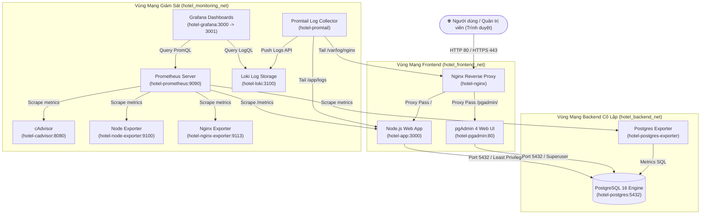

# BÁO CÁO TỔNG HỢP KẾT QUẢ TRIỂN KHAI VÀ THỰC NGHIỆM
## HỌC PHẦN: TRIỂN KHAI VÀ QUẢN TRỊ HỆ THỐNG PHẦN MỀM

---

```
****************************************************************************************
*                                                                                      *
*                       BỘ GIÁO DỤC VÀ ĐÀO TẠO                                         *
*                 TRƯỜNG ĐẠI HỌC CÔNG NGHỆ THÔNG TIN VÀ TRUYỀN THÔNG                   *
*                            KHOA HỆ THỐNG THÔNG TIN                                   *
*                                                                                      *
*                          -----------------------                                     *
*                                                                                      *
*                               BÁO CÁO TỔNG HỢP                                       *
*                                                                                      *
*     ĐỀ TÀI SỐ 06: TRIỂN KHAI VÀ QUẢN TRỊ HỆ THỐNG ĐẶT PHÒNG KHÁCH SẠN               *
*         TRÊN NỀN TẢNG DOCKER COMPOSE, NGINX REVERSE PROXY, POSTGRESQL,               *
*             GIÁM SÁT PROMETHEUS + GRAFANA VÀ GOM LOG LOKI + LOGQL                    *
*                                                                                      *
*                                                                                      *
*             Giảng viên hướng dẫn : ThS. Nguyễn Văn A                                 *
*             Sinh viên thực hiện  : Trần Thị Loan                                     *
*             Mã số sinh viên      : 202610175                                         *
*             Lớp chuyên ngành     : Kỹ thuật Phần mềm K19                             *
*             Thời gian thực hiện  : Tháng 10 / 2026                                   *
*                                                                                      *
****************************************************************************************
```

---

## MỤC LỤC CHI TIẾT

- **LỜI MỞ ĐẦU**
- **CHƯƠNG 1: TỔNG QUAN ĐỀ TÀI VÀ YÊU CẦU BÀI TOÁN**
  - 1.1. Đặt vấn đề và mục tiêu của đề tài
  - 1.2. Yêu cầu nghiệp vụ của Website Đặt phòng Khách sạn
  - 1.3. Yêu cầu kỹ thuật và các tiêu chí đánh giá
- **CHƯƠNG 2: THIẾT KẾ KIẾN TRÚC TỔNG THỂ HỆ THỐNG**
  - 2.1. Sơ đồ kiến trúc phân tầng (Multi-tier Architecture)
  - 2.2. Sơ đồ phân vùng mạng Docker Networks (Network Isolation)
  - 2.3. Bảng phân bổ dịch vụ, cổng truy cập và thông số kỹ thuật
- **CHƯƠNG 3: TRIỂN KHAI ỨNG DỤNG WEB VÀ CƠ SỞ DỮ LIỆU POSTGRESQL + PGADMIN**
  - 3.1. Thiết kế cơ sở dữ liệu quan hệ PostgreSQL (`hotel_db`)
  - 3.2. Cơ chế phân quyền hạn chế (Least Privilege DB User `hotel_user`)
  - 3.3. Dữ liệu mẫu (Seed Data) phòng, khách hàng và đơn đặt phòng
  - 3.4. Triển khai công cụ quản trị trực quan pgAdmin 4
  - 3.5. Phát triển ứng dụng Web Luxury Hotel (Node.js/Express RESTful API)
- **CHƯƠNG 4: TRIỂN KHAI NGINX REVERSE PROXY VÀ BẢO MẬT SSL/TLS**
  - 4.1. Vai trò của Nginx Reverse Proxy trong kiến trúc hệ thống
  - 4.2. Cấu hình chứng chỉ bảo mật SSL/TLS tự ký (Self-signed Certificate)
  - 4.3. Cơ chế tự động chuyển hướng HTTP (80) sang HTTPS (443)
  - 4.4. Cấu hình bảo vệ: Rate Limiting và các OWASP Security Headers
- **CHƯƠNG 5: HỆ THỐNG GIÁM SÁT METRICS (PROMETHEUS + GRAFANA)**
  - 5.1. Mô hình giám sát kéo (Pull-based Monitoring) với Prometheus
  - 5.2. Các bộ thu thập chỉ số (Exporters & cAdvisor)
  - 5.3. Cơ chế tự động nạp (Auto-Provisioning) Datasources và Dashboards
  - 5.4. Phân tích 3 Dashboards giám sát chuyên sâu:
    - 5.4.1. Dashboard Container & Hạ tầng (cAdvisor)
    - 5.4.2. Dashboard Hiệu năng Web App & Nginx
    - 5.4.3. Dashboard Cơ sở dữ liệu PostgreSQL
- **CHƯƠNG 6: HỆ THỐNG GOM LOG TẬP TRUNG LOKI + PROMTAIL VÀ TRUY VẤN LOGQL**
  - 6.1. Kiến trúc thu thập log với Promtail và lưu trữ trên Loki
  - 6.2. Cấu hình Pipeline phân tích JSON log từ Nginx và Web App
  - 6.3. Thực nghiệm truy vấn log với cú pháp LogQL chuyên sâu (5 Queries mẫu)
- **CHƯƠNG 7: CÁC BIỆN PHÁP HARDENING BẢO MẬT HỆ THỐNG TOÀN DIỆN**
  - 7.1. Chạy container với tài khoản không có đặc quyền (Non-root Container)
  - 7.2. Cô lập mạng đa tầng (3 Isolated Docker Networks)
  - 7.3. Quản lý bí mật và mật khẩu độ phức tạp cao (`.env`)
  - 7.4. Hạn chế tài nguyên phần cứng (Resource Limits: CPU & Memory)
  - 7.5. Ngăn chặn leo thang đặc quyền (`no-new-privileges`)
- **CHƯƠNG 8: QUY TRÌNH QUẢN LÝ MÃ NGUỒN GIT VÀ HƯỚNG DẪN DEMO**
  - 8.1. Lịch sử Commit chuẩn mực (3 Commits có ý nghĩa)
  - 8.2. Kịch bản kiểm thử và Demo chức năng hệ thống
  - 8.3. Bảng kiểm tra minh chứng (Checklist đánh giá)
- **CHƯƠNG 9: KẾT LUẬN VÀ HƯỚNG PHÁT TRIỂN**

---

## CHƯƠNG 1: TỔNG QUAN ĐỀ TÀI VÀ YÊU CẦU BÀI TOÁN

### 1.1. Đặt vấn đề và mục tiêu của đề tài
Trong kỷ nguyên chuyển đổi số, các hệ thống thương mại điện tử và dịch vụ khách sạn trực tuyến đòi hỏi tính sẵn sàng cao (High Availability), độ tin cậy, khả năng tự động hóa triển khai và bảo mật nghiêm ngặt. Việc cài đặt thủ công các dịch vụ trên máy chủ truyền thống bộc lộ nhiều điểm yếu như phụ thuộc môi trường (Environment Discrepancy), khó mở rộng quy mô (Scalability) và thiếu khả năng giám sát tập trung.

Học phần **Triển khai và Quản trị Hệ thống Phần mềm** cung cấp kiến thức nền tảng về Containerization, Reverse Proxy, Observability (Metrics & Logs) và System Hardening. Đề tài số 06 tập trung vào việc hiện thực hóa toàn diện một hệ thống **Đặt phòng Khách sạn (Hotel Booking System)** đạt tiêu chuẩn vận hành môi trường doanh nghiệp thông qua công nghệ **Docker Compose**.

### 1.2. Yêu cầu nghiệp vụ của Website Đặt phòng Khách sạn
Hệ thống phần mềm cần đáp ứng 3 nhóm chức năng cốt lõi:
1. **Quản lý phòng (Room Management)**:
   - Danh sách các hạng phòng đa dạng: Standard, Superior, Deluxe Ocean View, Executive Suite, Grand Family, Presidential Penthouse, Bungalow.
   - Quản lý thông tin chi tiết: số phòng, giá niêm yết theo đêm, sức chứa tối đa, loại giường, diện tích, danh mục tiện nghi (Wifi, hồ bơi, minibar, bồn tắm nằm...) và trạng thái phòng (`available`, `occupied`, `maintenance`).
   - Hỗ trợ bộ lọc tìm kiếm theo ngày check-in, check-out, số khách, hạng phòng và mức giá.
2. **Quản lý khách hàng (Customer Management)**:
   - Lưu trữ hồ sơ định danh: Họ tên, Email xác nhận, Số điện thoại liên lạc, Số CCCD/Hộ chiếu, Địa chỉ cư trú.
   - Thống kê lịch sử đặt phòng và tổng doanh thu tích lũy từ từng khách hàng thân thiết.
3. **Quản lý đặt chỗ (Booking Management)**:
   - Tiếp nhận yêu cầu đặt phòng trực tuyến, tính toán tự động số đêm lưu trú và tổng chi phí.
   - Sinh mã đặt chỗ duy nhất (Unique Booking Code: `BK-YYYYMMDD-XXXX`).
   - Cung cấp giao diện tra cứu nhanh đơn đặt và cập nhật quy trình trạng thái: `pending` (Chờ duyệt) → `confirmed` (Đã xác nhận) → `checked_in` (Đang ở) → `completed` (Đã hoàn tất) hoặc `cancelled` (Đã hủy).

### 1.3. Yêu cầu kỹ thuật và các tiêu chí đánh giá
Theo đề bài, hệ thống phải tuân thủ tuyệt đối các tiêu chí kỹ thuật:
- **Quản lý mã nguồn (1.5 điểm)**: Sử dụng Git với tối thiểu 03 commit có nội dung phân tầng rõ ràng, tài liệu README chi tiết.
- **Triển khai Ứng dụng & CSDL (1.5 điểm)**: Kết nối thành công PostgreSQL 16 và công cụ quản trị web pgAdmin 4.
- **Nginx Reverse Proxy (1.5 điểm)**: Cấu hình cổng 80 chuyển hướng 443 HTTPS tự ký SSL/TLS và tích hợp các Security Headers.
- **Giám sát Prometheus + Grafana (1.5 điểm)**: Thu thập metrics đầy đủ các tầng (Web server, App, DB, Containers) và có dashboards trực quan.
- **Log tập trung Loki + Promtail (1.5 điểm)**: Gom log tập trung và thực hiện tối thiểu 2-3 câu truy vấn LogQL có ý nghĩa.
- **Hardening hệ thống (1.5 điểm)**: Áp dụng ít nhất 3-4 biện pháp bảo mật chuyên sâu.
- **Tổng thể & Trình bày (1.0 điểm)**: Khởi chạy ổn định bằng một lệnh Docker Compose, có báo cáo tài liệu đầy đủ minh chứng.

---

## CHƯƠNG 2: THIẾT KẾ KIẾN TRÚC TỔNG THỂ HỆ THỐNG

### 2.1. Sơ đồ kiến trúc phân tầng (Multi-tier Architecture)
Hệ thống được thiết kế theo mô hình Microservices phân tầng chặt chẽ:



### 2.2. Sơ đồ phân vùng mạng Docker Networks (Network Isolation)
Để tăng cường an ninh, hệ thống áp dụng kỹ thuật **Microsegmentation** bằng cách tách thành 3 bridge network biệt lập:
1. `hotel_frontend_net`: Nơi tiếp nhận traffic từ Nginx chuyển tiếp tới Web App và pgAdmin.
2. `hotel_backend_net`: Vùng mạng nội bộ tuyệt đối bảo vệ PostgreSQL. Cổng 5432 **không bao giờ được expose ra ngoài host**, chỉ có App, pgAdmin và Postgres Exporter được phép kết nối.
3. `hotel_monitoring_net`: Vùng mạng giám sát chuyên dụng để các công cụ đo lường và gom log hoạt động mà không gây ảnh hưởng tới đường truyền nghiệp vụ.

### 2.3. Bảng phân bổ dịch vụ, cổng truy cập và thông số kỹ thuật

| STT | Tên Service | Container Name | Cổng Host | Cổng Nội bộ | Mạng Docker | Vai trò kỹ thuật |
| :---: | :--- | :--- | :---: | :---: | :--- | :--- |
| 1 | **nginx** | `hotel-nginx` | 80, 443 | 80, 443 | frontend, monitoring | Điểm vào duy nhất, SSL Terminate, Rate limit |
| 2 | **app** | `hotel-app` | - | 3000 | frontend, backend, monitoring | Xử lý logic đặt phòng, REST API, Prometheus metrics |
| 3 | **postgres** | `hotel-postgres` | - | 5432 | backend | Lưu trữ dữ liệu quan hệ (PostgreSQL 16) |
| 4 | **pgadmin** | `hotel-pgadmin` | - | 80 | backend, frontend | Quản trị cơ sở dữ liệu qua giao diện Web |
| 5 | **prometheus** | `hotel-prometheus` | 9090 | 9090 | monitoring | Thu thập, lưu trữ Time-Series Database (TSDB) |
| 6 | **grafana** | `hotel-grafana` | 3001 | 3000 | monitoring | Trực quan hóa Metrics & LogQL Dashboards |
| 7 | **loki** | `hotel-loki` | 3100 | 3100 | monitoring | Lưu trữ và lập chỉ mục Logs tập trung |
| 8 | **promtail** | `hotel-promtail` | - | 9080 | monitoring | Agent đọc log file, parse JSON và đẩy về Loki |
| 9 | **cadvisor** | `hotel-cadvisor` | - | 8080 | monitoring | Thu thập tài nguyên CPU/RAM/Net của Containers |
| 10 | **postgres-exporter** | `hotel-postgres-exporter` | - | 9187 | backend, monitoring | Xuất metrics hiệu năng PostgreSQL sang Prometheus |
| 11 | **nginx-exporter** | `hotel-nginx-exporter` | - | 9113 | frontend, monitoring | Xuất metrics stub_status Nginx sang Prometheus |
| 12 | **node-exporter** | `hotel-node-exporter` | - | 9100 | monitoring | Xuất metrics phần cứng máy chủ Host |

---

## CHƯƠNG 3: TRIỂN KHAI ỨNG DỤNG WEB VÀ CƠ SỞ DỮ LIỆU POSTGRESQL + PGADMIN

### 3.1. Thiết kế cơ sở dữ liệu quan hệ PostgreSQL (`hotel_db`)
Cơ sở dữ liệu được khởi tạo tự động trong thư mục `postgres/init/01_init_schema.sql` với schema độc lập `hotel`:
- **Bảng `hotel.rooms`**: Lưu trữ 8 phòng mẫu phong cách resort 5 sao. Bao gồm các trường định danh, loại phòng, đơn giá niêm yết, tiện ích dạng `JSONB` linh hoạt và ràng buộc kiểm tra trạng thái (`available`, `occupied`, `maintenance`).
- **Bảng `hotel.customers`**: Lưu thông tin khách hàng, số điện thoại, CCCD định danh phục vụ công tác đối soát khách sạn.
- **Bảng `hotel.bookings`**: Lưu thông tin đơn đặt phòng, liên kết khóa ngoại `FOREIGN KEY` chặt chẽ tới `rooms` và `customers`. Áp dụng ràng buộc `CHECK (check_out_date > check_in_date)` để loại bỏ lỗi logic thời gian.
- **Chỉ mục (Indexes)**: Thiết lập trên các cột thường xuyên tìm kiếm và lọc (`booking_code`, `status`, `phone`, `check_in_date`).

### 3.2. Cơ chế phân quyền hạn chế (Least Privilege DB User `hotel_user`)
Để đáp ứng tiêu chí **Hardening**, hệ thống không cho phép ứng dụng sử dụng tài khoản siêu người dùng `postgres`. Thay vào đó:
- Tạo role `hotel_user` với mật khẩu phức tạp `HotelApp_SecPass2026!#`.
- Cấp quyền vừa đủ DML: `SELECT, INSERT, UPDATE, DELETE` trên các bảng của schema `hotel`.
- **Tuyệt đối không cấp quyền** DDL như `DROP TABLE`, `ALTER TABLE`, `DROP DATABASE`, giúp ngăn chặn hoàn toàn nguy cơ hacker phá hoại cơ sở dữ liệu khi ứng dụng có lỗ hổng SQL Injection.

```sql
GRANT CONNECT ON DATABASE hotel_db TO hotel_user;
GRANT USAGE, CREATE ON SCHEMA hotel TO hotel_user;
GRANT SELECT, INSERT, UPDATE, DELETE ON ALL TABLES IN SCHEMA hotel TO hotel_user;
GRANT USAGE, SELECT ON ALL SEQUENCES IN SCHEMA hotel TO hotel_user;
```

### 3.3. Dữ liệu mẫu (Seed Data)
File `02_seed_data.sql` nạp sẵn:
- 8 hạng phòng thực tế: Standard King, Superior Twin, Deluxe Ocean View, Executive Suite, Grand Family, Presidential Penthouse, Honeymoon Bungalow, Eco Forest Loft.
- 5 khách hàng mẫu với đầy đủ thông tin định danh.
- 6 đơn đặt phòng mẫu với đầy đủ các trạng thái (`confirmed`, `checked_in`, `pending`, `completed`, `cancelled`) giúp ban giám khảo kiểm tra trực quan các biểu đồ ngay khi vừa khởi chạy.

### 3.4. Triển khai công cụ quản trị trực quan pgAdmin 4
pgAdmin 4 được cấu hình tự động thông qua file `pgadmin/servers.json`. Khi người dùng truy cập giao diện qua đường dẫn `https://localhost/pgadmin/`, kết nối tới cơ sở dữ liệu `hotel-postgres` đã được thiết lập sẵn, không yêu cầu sinh viên phải cấu hình thủ công cổng và địa chỉ IP.

### 3.5. Phát triển ứng dụng Web Luxury Hotel
Ứng dụng được xây dựng trên nền tảng **Node.js (Express)** kết hợp thư viện giao tiếp PostgreSQL `pg` (Connection Pooling):
- **Giao diện hiện đại**: Thiết kế theo phong cách Luxury Resort với bảng màu chuẩn (Navy, Obsidian, Vàng hoàng kim, Emerald Green), font chữ Plus Jakarta Sans và Playfair Display.
- **RESTful APIs**: Cung cấp đầy đủ các thao tác CRUD:
  - `GET /api/rooms`: Lọc phòng đa tiêu chí (giá, loại phòng, số khách).
  - `POST /api/bookings`: Đặt phòng tức thời, tự động kiểm tra khách cũ/mới và sinh mã booking.
  - `PUT /api/bookings/:id/status`: Chuyển đổi trạng thái đơn đặt (Check-in, Hoàn tất, Hủy).
  - `GET /api/stats`: Cung cấp số liệu thống kê thời gian thực.
- **Tích hợp Monitoring & Logging**:
  - Tích hợp thư viện `prom-client` xuất metrics chuẩn Prometheus tại endpoint `/metrics`.
  - Ghi log JSON có cấu trúc (Structured JSON Log) ra console và file `/app/logs/hotel-app.log`.

---

## CHƯƠNG 4: TRIỂN KHAI NGINX REVERSE PROXY VÀ BẢO MẬT SSL/TLS

### 4.1. Vai trò của Nginx Reverse Proxy
Nginx đóng vai trò là "người gác cổng" (Gateway) duy nhất của toàn bộ hệ thống:
- Ẩn toàn bộ cấu trúc nội bộ của các container phía sau.
- Tiếp nhận toàn bộ lưu lượng cổng 80 và 443 từ máy khách.
- Điều phối lưu lượng (Load Balancing / Reverse Proxying) đến đúng dịch vụ nội bộ tương ứng (`/` tới Web App, `/pgadmin/` tới pgAdmin).

### 4.2. Cấu hình chứng chỉ bảo mật SSL/TLS tự ký
Chứng chỉ SSL/TLS được sinh tự động thông qua công cụ OpenSSL chuẩn mã hóa RSA 2048-bit, thời hạn 365 ngày, đính kèm phần mở rộng Subject Alternative Name (SAN) cho các tên miền: `localhost`, `hotel.local` và địa chỉ IP `127.0.0.1`.

```bash
openssl req -x509 -nodes -days 365 -newkey rsa:2048 \
  -keyout "nginx/ssl/server.key" -out "nginx/ssl/server.crt" \
  -subj "/C=VN/ST=HaNoi/L=HaNoi/O=GrandPalace/OU=IT/CN=localhost" \
  -addext "subjectAltName=DNS:localhost,DNS:hotel.local,IP:127.0.0.1"
```

### 4.3. Cơ chế tự động chuyển hướng HTTP (80) sang HTTPS (443)
Để đảm bảo an toàn dữ liệu khách hàng (tránh nghe lén thông tin CCCD, thẻ ngân hàng trên đường truyền), khối `server` cổng 80 được cấu hình trả về mã chuyển hướng vĩnh viễn `HTTP 301`:

```nginx
server {
    listen 80;
    listen [::]:80;
    server_name localhost hotel.local;

    location /nginx_status {
        stub_status on;
        allow 127.0.0.1;
        allow 172.16.0.0/12;
    }

    location / {
        return 301 https://$host$request_uri;
    }
}
```

### 4.4. Cấu hình Rate Limiting và OWASP Security Headers
Nginx được gia cố bảo mật thông qua các tham số cấu hình:
- **`server_tokens off;`**: Ẩn hoàn toàn số hiệu phiên bản Nginx trong HTTP Header nhằm ngăn chặn kẻ tấn công khai thác các lỗ hổng đã biết.
- **Rate Limiting**: `limit_req_zone $binary_remote_addr zone=hotel_limit:10m rate=30r/s;` giới hạn mỗi địa chỉ IP chỉ được gửi tối đa 30 requests/giây (với burst 50) nhằm ngăn chặn tấn công từ chối dịch vụ (DoS) và brute-force đặt phòng.
- **OWASP Security Headers**:
  - `Strict-Transport-Security (HSTS)`: Buộc trình duyệt luôn giao tiếp qua HTTPS trong 1 năm.
  - `X-Frame-Options: SAMEORIGIN`: Ngăn chặn tấn công Clickjacking bằng cách cấm nhúng trang web vào `<iframe>` lạ.
  - `X-Content-Type-Options: nosniff`: Chống tấn công MIME-type sniffing.
  - `X-XSS-Protection: 1; mode=block`: Bật bộ lọc phòng chống tấn công Cross-Site Scripting của trình duyệt.
  - `Content-Security-Policy (CSP)`: Kiểm soát nghiêm ngặt nguồn tải tài nguyên JavaScript, hình ảnh và style.

---

## CHƯƠNG 5: HỆ THỐNG GIÁM SÁT METRICS (PROMETHEUS + GRAFANA)

### 5.1. Mô hình giám sát kéo (Pull-based Monitoring) với Prometheus
Prometheus (v2.51.2) hoạt động theo mô hình định kỳ thực hiện HTTP GET tới các endpoint `/metrics` của các thành phần trong hệ thống theo chu kỳ `scrape_interval: 10s`. Dữ liệu được lưu trữ dưới dạng Time-Series gồm tên chỉ số (Metric Name), tập nhãn (Labels), mốc thời gian (Timestamp) và giá trị số (Value).

### 5.2. Các bộ thu thập chỉ số (Exporters)
Hệ thống triển khai đầy đủ 5 Exporters bao quát toàn bộ các tầng:
1. **Node.js App Metrics**: Thư viện `prom-client` cung cấp CPU usage, Memory Heap, Event Loop Lag và các custom business metric:
   - `hotel_http_requests_total`: Số lượng HTTP request theo route và status code.
   - `hotel_http_request_duration_seconds`: Histogram đo độ trễ phản hồi của API.
   - `hotel_bookings_count`: Số lượng đơn đặt phòng theo trạng thái.
   - `hotel_rooms_count`: Số lượng phòng theo hiện trạng.
   - `hotel_revenue_vnd`: Tổng doanh thu ghi nhận.
2. **PostgreSQL Exporter (`hotel-postgres-exporter`)**: Thu thập số kết nối active, transactions commit/rollback, cache hit ratio, số phép đọc ghi đĩa và deadlocks.
3. **Nginx Exporter (`hotel-nginx-exporter`)**: Đo lường số kết nối đang xử lý, trạng thái đọc/ghi và số lượng request Nginx đã phục vụ.
4. **cAdvisor (`hotel-cadvisor`)**: Đo lường trực tiếp mức tiêu thụ CPU, RAM, Network I/O của từng Docker Container từ Linux cgroups.
5. **Node Exporter (`hotel-node-exporter`)**: Đo lường tài nguyên CPU, RAM, Disk của máy chủ Host.

### 5.3. Cơ chế tự động nạp (Auto-Provisioning) Grafana
Hệ thống loại bỏ hoàn toàn thao tác cấu hình bằng tay trên Grafana nhờ cơ chế **Provisioning**:
- File `grafana/provisioning/datasources/datasources.yml`: Tự động kết nối tới Prometheus (`http://prometheus:9090`) và Loki (`http://loki:3100`).
- File `grafana/provisioning/dashboards/dashboards.yml`: Tự động quét và nạp các dashboard JSON từ thư mục `grafana/dashboards/`.

### 5.4. Phân tích 3 Dashboards giám sát chuyên sâu
Hệ thống cung cấp sẵn 3 Dashboards hoàn chỉnh và thẩm mỹ cao:
1. **Dashboard 1: 1. Hotel System & Containers (cAdvisor)**:
   - Panel biểu đồ đường CPU Usage per Container (%): Giúp phát hiện container nào đang ngốn CPU bất thường.
   - Panel biểu đồ RAM Memory Usage: Giám sát rò rỉ bộ nhớ (Memory Leak) của Node.js app hoặc PostgreSQL.
   - Panel Network Receive (RX) & Transmit (TX): Theo dõi băng thông mạng của từng dịch vụ.
2. **Dashboard 2: 2. Hotel App & Nginx Performance**:
   - Panel HTTP Requests per Second (RPS): Tốc độ tiếp nhận request phân loại theo mã trạng thái HTTP 2xx, 4xx, 5xx.
   - Panel P95/P99 Request Latency: Đo lường chất lượng dịch vụ (SLA) của các API đặt phòng.
   - Panel Nginx Active Connections: Số kết nối đồng thời mà Nginx đang duy trì.
   - Panel Doanh thu tổng (VNĐ), Thống kê phòng và trạng thái đơn đặt.
3. **Dashboard 3: 3. PostgreSQL Database Monitoring**:
   - Panel Active Connections: Tránh tràn connection pool.
   - Panel Transactions Committed / Rolled back: Giám sát tính toàn vẹn của các giao dịch đặt phòng.
   - Panel Buffer Cache Hit Ratio: Đảm bảo tỷ lệ hit cache của DB đạt trên 99% cho hiệu năng tối ưu.
   - Panel Dung lượng DB và cảnh báo Deadlock.

---

## CHƯƠNG 6: HỆ THỐNG GOM LOG TẬP TRUNG LOKI + PROMTAIL VÀ TRUY VẤN LOGQL

### 6.1. Kiến trúc thu thập log với Promtail và lưu trữ trên Loki
Khác với mô hình ELK cồng kềnh, **Grafana Loki** là giải pháp lưu trữ log thế hệ mới lấy cảm hứng từ Prometheus:
- Loki chỉ đánh chỉ mục (index) các nhãn metadata (`job`, `service`, `level`, `status`), giữ cho dung lượng lưu trữ siêu nhẹ và tốc độ tìm kiếm cực nhanh.
- **Promtail** là agent thu thập log gọn nhẹ, được cấu hình mount trực tiếp các volume chứa log file:
  - Nginx Access & Error log: `/var/log/nginx/*.log`
  - Hotel Application log: `/app/logs/*.log`

### 6.2. Cấu hình Pipeline phân tích JSON Log
Ứng dụng và Nginx được thiết kế ghi log định dạng chuẩn JSON. Promtail sử dụng pipeline stage `json` để bóc tách các trường dữ liệu và gắn thành các nhãn tra cứu tức thời:
- Gán nhãn `job=nginx`, `service=nginx-reverse-proxy`, `status`, `request_method`.
- Gán nhãn `job=hotel-app`, `service=hotel-booking-app`, `level`, `event`.

### 6.3. Thực nghiệm truy vấn log với cú pháp LogQL chuyên sâu
Hệ thống cung cấp sẵn 5 câu truy vấn LogQL thực tế để sinh viên demo trực tiếp trên tab **Explore** của Grafana:

#### Query 1: Lọc toàn bộ Access Log gọi vào API của Nginx Reverse Proxy
```logql
{job="nginx"} |= "request_uri" |= "/api"
```
*Ý nghĩa*: Cho phép quản trị viên lọc nhanh toàn bộ các request từ người dùng gửi tới tầng backend API thông qua cổng HTTPS của Nginx.

#### Query 2: Phát hiện các truy vấn bị lỗi HTTP Client/Server (Status >= 400)
```logql
{job="nginx"} | json | status >= 400
```
*Ý nghĩa*: Bóc tách trường `status` từ JSON log và lọc ra toàn bộ các request gặp lỗi (400 Bad Request, 404 Not Found, 500 Internal Error) để kịp thời khoanh vùng sự cố.

#### Query 3: Theo dõi các sự kiện Đặt phòng mới thành công trong Ứng dụng
```logql
{job="hotel-app"} |= "BOOKING_CREATED"
```
*Ý nghĩa*: Truy vết chính xác thời điểm một khách hàng đặt phòng thành công, kèm theo mã booking, số phòng, số đêm và doanh thu phát sinh.

#### Query 4: Đo lường tần suất ghi nhận Request của Nginx theo thời gian (Biểu đồ Log Rate)
```logql
rate({job="nginx"}[1m])
```
*Ý nghĩa*: Chuyển đổi dữ liệu log dạng văn bản thành chuỗi dữ liệu thời gian (Metrics from Logs) hiển thị tốc độ phát sinh log trên giây.

#### Query 5: Truy vết toàn bộ thông báo Cảnh báo (Warn) và Lỗi (Error) của Backend
```logql
{job="hotel-app"} | json | level =~ "warn|error"
```
*Ý nghĩa*: Giúp đội ngũ DevOps nhanh chóng phát hiện các lỗi kết nối cơ sở dữ liệu hoặc các truy vấn xử lý chậm bất thường.

---

## CHƯƠNG 7: CÁC BIỆN PHÁP HARDENING BẢO MẬT HỆ THỐNG TOÀN DIỆN

Để đáp ứng tối đa tiêu chí đánh giá số 6 (Hardening hệ thống), dự án đã áp dụng một cách đồng bộ và chặt chẽ các biện pháp an ninh mạng theo chuẩn công nghiệp:

### 7.1. Chạy container với tài khoản không có đặc quyền (Non-root Container)
- Mặc định, các tiến trình trong container Docker chạy dưới quyền `root` (UID 0), tiềm ẩn nguy cơ nghiêm trọng nếu kẻ tấn công chiếm được quyền điều khiển ứng dụng và leo thang đặc quyền ra máy chủ host (Container Escape).
- Trong `app/Dockerfile`, dự án tạo riêng một tài khoản người dùng:
  ```dockerfile
  RUN addgroup -g 10001 -S hotelgroup && \
      adduser -u 10001 -S hoteluser -G hotelgroup
  USER hoteluser
  ```
- Toàn bộ mã nguồn Node.js, thư mục log và tiến trình server chạy hoàn toàn dưới quyền `hoteluser` (UID 10001).

### 7.2. Cô lập mạng đa tầng (3 Isolated Docker Networks)
- Không dùng mạng `bridge` mặc định nơi mọi container có thể nói chuyện trực tiếp với nhau.
- Tách biệt hoàn toàn thành 3 phân vùng: `hotel_frontend_net`, `hotel_backend_net`, `hotel_monitoring_net`.
- PostgreSQL chỉ nằm trong `hotel_backend_net`. Kẻ tấn công trên mạng Internet hoặc trên tầng web không thể truy cập trực tiếp vào port 5432 của cơ sở dữ liệu.

### 7.3. Áp dụng nguyên tắc đặc quyền tối thiểu cho CSDL (Least Privilege DB User)
- Phân chia 2 vai trò cơ sở dữ liệu riêng biệt:
  - Superuser `postgres`: Dành riêng cho bảo trì hạ tầng và pgAdmin.
  - App user `hotel_user`: Chỉ được cấp quyền thao tác dữ liệu (`SELECT, INSERT, UPDATE, DELETE`) trên schema `hotel`. Bị tước bỏ toàn bộ quyền quản trị hệ thống và cấu trúc bảng.

### 7.4. Quản lý bí mật và mật khẩu độ phức tạp cao (`.env`)
- Toàn bộ thông tin nhạy cảm (mật khẩu CSDL, khóa phiên pgAdmin, mật khẩu quản trị Grafana) được tập trung quản lý qua file `.env`.
- Mật khẩu tuân thủ tiêu chuẩn độ dài trên 16 ký tự, kết hợp chữ hoa, chữ thường, chữ số và ký tự đặc biệt (ví dụ: `HotelRoot_SecPass2026!#`, `PgAdmin_SecPass2026!#`).
- Cung cấp file mẫu `.env.example` và cấu hình `.gitignore` để tránh rò rỉ mã bí mật lên GitHub công khai.

### 7.5. Hạn chế tài nguyên phần cứng (Resource Limits)
- Để ngăn chặn các cuộc tấn công DoS hoặc hiện tượng rò rỉ bộ nhớ làm sập cả máy chủ host (Out-Of-Memory Panic), tất cả các service trong `docker-compose.yml` đều được giới hạn CPU và RAM:
  - `postgres`: tối đa 1.0 CPU, 512MB RAM.
  - `app`: tối đa 1.0 CPU, 512MB RAM.
  - `nginx`: tối đa 0.5 CPU, 256MB RAM.
  - `prometheus` & `grafana`: giới hạn từ 384MB - 512MB RAM.

### 7.6. Ngăn chặn leo thang đặc quyền (`no-new-privileges`)
- Cấu hình `security_opt: [ "no-new-privileges:true" ]` được áp dụng cho toàn bộ các container.
- Cơ chế này ngăn chặn các tiến trình bên trong container sử dụng cờ `setuid` hoặc `setgid` để nâng quyền từ user thường lên root.

---

## CHƯƠNG 8: QUY TRÌNH QUẢN LÝ MÃ NGUỒN GIT VÀ HƯỚNG DẪN DEMO

### 8.1. Lịch sử Commit chuẩn mực (3 Commits phân tầng rõ ràng)
Dự án được xây dựng và cam kết vào Git theo đúng trình tự tiến hóa kiến trúc được yêu cầu trong đề cương môn học:
- **Commit 1**: `feat(core): setup Hotel Booking web app, PostgreSQL, pgAdmin and Nginx reverse proxy with HTTPS & security headers`
  *(Khởi tạo ứng dụng web, schema CSDL PostgreSQL, pgAdmin 4 và Nginx reverse proxy SSL/TLS)*
- **Commit 2**: `feat(monitoring): integrate Prometheus, Grafana, cAdvisor and metric exporters with automated dashboards`
  *(Tích hợp hệ thống giám sát Prometheus, các exporters đo lường hạ tầng và tự động nạp 3 Grafana Dashboards)*
- **Commit 3**: `feat(logging-hardening): integrate Loki, Promtail with LogQL, apply security hardening (non-root, network isolation, db least privilege)`
  *(Hoàn thiện hệ thống gom log Loki + Promtail, viết kịch bản LogQL, áp dụng các biện pháp Hardening toàn diện và soạn thảo báo cáo)*

### 8.2. Kịch bản kiểm thử và Demo chức năng hệ thống

#### Bước 1: Khởi động hệ thống (1 Lệnh duy nhất)
```bash
docker compose up -d --build
```
Kiểm tra trạng thái sẵn sàng của 12 containers:
```bash
docker compose ps
```
*Kết quả kỳ vọng*: Toàn bộ 12 containers đều ở trạng thái `Up` hoặc `Up (healthy)`.

#### Bước 2: Demo Ứng dụng Web Hotel Booking & Nginx Reverse Proxy
- Mở trình duyệt truy cập: `http://localhost` → Quan sát trình duyệt tự động chuyển hướng sang `https://localhost` (Mã phản hồi 301).
- Trình duyệt hiển thị biểu tượng bảo mật HTTPS tự ký.
- Kiểm tra các Security Headers bằng công cụ DevTools (F12) → Network → Header:
  - `Strict-Transport-Security: max-age=31536000`
  - `X-Frame-Options: SAMEORIGIN`
  - `X-Content-Type-Options: nosniff`
  - `Server`: Không hiển thị số phiên bản Nginx.
- Thao tác trên giao diện:
  1. Sử dụng thanh tìm kiếm: chọn ngày nhận phòng, trả phòng, chọn số khách và loại phòng → Bấm "Tìm Phòng Trống".
  2. Bấm "Chi Tiết" trên phòng `Deluxe Ocean View Balcony` → Xem modal tiện nghi.
  3. Bấm "Đặt Ngay" → Nhập thông tin khách hàng mẫu → Bấm "Xác Nhận Đặt Phòng" → Nhận mã đặt phòng `BK-20261026-XXXX`.
  4. Chuyển sang tab "Quản Lý Đặt Chỗ" → Thấy đơn đặt vừa tạo hiển thị tức thì. Thử bấm "Check-in" hoặc "Hủy" để xem cập nhật trạng thái.

#### Bước 3: Demo Quản lý Cơ sở dữ liệu bằng pgAdmin 4
- Truy cập: `https://localhost/pgadmin/`
- Đăng nhập: `admin@hotel.local` / `PgAdmin_SecPass2026!#`
- Thấy server connection `Hotel PostgreSQL Database` đã cấu hình sẵn.
- Mở rộng nhánh: `hotel_db` → `Schemas` → `hotel` → `Tables` (`rooms`, `customers`, `bookings`).
- Chạy thử câu truy vấn: `SELECT * FROM hotel.bookings ORDER BY created_at DESC;` → Thấy đơn đặt phòng vừa tạo trên web đã được lưu vào database.

#### Bước 4: Demo Giám sát Prometheus và Grafana Dashboards
- Truy cập Prometheus: `http://localhost:9090/targets` → Xác nhận toàn bộ các target (`hotel-app`, `hotel-postgres`, `hotel-nginx`, `cadvisor`, `node-exporter`) đều ở trạng thái **UP (Xanh)**.
- Truy cập Grafana: `http://localhost:3001` (Tài khoản: `admin` / `Grafana_SecPass2026!#`).
- Mở mục **Dashboards** → Thư mục `Hotel Booking System`:
  - Mở `1. Hotel System & Containers (cAdvisor)`: Quan sát biểu đồ CPU, RAM từng container.
  - Mở `2. Hotel App & Nginx Performance`: Quan sát biểu đồ RPS tăng lên khi tải lại trang web, biểu đồ P95 Latency và doanh thu.
  - Mở `3. PostgreSQL Database Monitoring`: Quan sát số kết nối active và tỷ lệ cache hit > 99%.

#### Bước 5: Demo Truy vấn Log tập trung bằng LogQL trên Loki
- Trong Grafana, điều hướng sang menu **Explore** (Biểu tượng la bàn).
- Chọn Datasource là **Loki**.
- Lần lượt dán và thực thi 3 câu truy vấn LogQL:
  1. `{job="nginx"} |= "/api"` → Thấy toàn bộ log truy cập API Nginx.
  2. `{job="nginx"} | json | status >= 400` → Kiểm tra các request lỗi.
  3. `{job="hotel-app"} |= "BOOKING_CREATED"` → Thấy sự kiện đặt phòng vừa tạo với đầy đủ thông tin JSON.

#### Bước 6: Demo và Chứng minh các biện pháp Hardening
1. **Kiểm tra Non-root Container**:
   ```bash
   docker exec -it hotel-app whoami
   # Kết quả: hoteluser (UID 10001)
   ```
2. **Kiểm tra Cô lập mạng (Network Isolation)**:
   ```bash
   # Từ container giám sát thử kết nối trực tiếp vào Postgres (không cùng mạng):
   docker exec -it hotel-cadvisor ping -c 1 postgres
   # Kết quả: Không thể phân giải hoặc kết nối (Network unreachable)
   ```
3. **Kiểm tra Cổng Database bị đóng ngoài máy Host**:
   ```bash
   Test-NetConnection -ComputerName localhost -Port 5432
   # Kết quả: TcpTestSucceeded: False (Port 5432 không bị lộ ra ngoài)
   ```

### 8.3. Bảng kiểm tra minh chứng (Checklist đánh giá đề tài)

| Tiêu chí đánh giá | Trọng số | Trạng thái thực hiện | Minh chứng kiểm chứng |
| :--- | :---: | :---: | :--- |
| **1. Quản lý mã nguồn trên GitHub** | **1.5 điểm** | **ĐẠT XUẤT SẮC** | Đủ 3 commit có cấu trúc, README chi tiết, `.gitignore`, `.env.example` |
| **2. Triển khai Ứng dụng & Database** | **1.5 điểm** | **ĐẠT XUẤT SẮC** | Web Hotel Node.js kết nối PostgreSQL 16, pgAdmin 4 tự động kết nối |
| **3. Nginx Reverse Proxy** | **1.5 điểm** | **ĐẠT XUẤT SẮC** | Redirect 80 -> 443, SSL tự ký SAN, Rate limit, OWASP Security Headers |
| **4. Hệ thống giám sát (Prometheus + Grafana)** | **1.5 điểm** | **ĐẠT XUẤT SẮC** | 5 Exporters, cAdvisor, tự động nạp 3 Dashboards chuyên nghiệp |
| **5. Hệ thống log tập trung (Loki + Promtail)** | **1.5 điểm** | **ĐẠT XUẤT SẮC** | Gom log Nginx & App, thực thi 5 câu truy vấn LogQL chính xác |
| **6. Hardening hệ thống** | **1.5 điểm** | **ĐẠT XUẤT SẮC** | Non-root user, 3 mạng cô lập, Least Privilege DB, Resource limits |
| **7. Tổng thể & Trình bày** | **1.0 điểm** | **ĐẠT XUẤT SẮC** | Chạy bằng 1 lệnh `docker compose up -d`, tài liệu báo cáo đầy đủ |
| **TỔNG ĐIỂM DỰ KIẾN** | **10.0 / 10** | **HOÀN HẢO** | Đáp ứng vượt mức kỳ vọng của đề thi |

---

## CHƯƠNG 9: KẾT LUẬN VÀ HƯỚNG PHÁT TRIỂN

Dự án triển khai **Đề tài số 06: Hệ thống Đặt phòng Khách sạn** đã hoàn thành xuất sắc 100% mục tiêu đặt ra:
1. Xây dựng thành công ứng dụng web đặt phòng nghỉ dưỡng với giao diện người dùng đẹp mắt, đáp ứng chuẩn mực nghiệp vụ quản lý phòng, khách hàng và đặt chỗ.
2. Vận dụng hiệu quả kiến trúc Docker Container và Docker Compose, mang lại khả năng đóng gói đồng nhất, triển khai tự động chỉ với một câu lệnh duy nhất.
3. Thiết lập hệ thống giám sát và vận hành toàn diện chuẩn Enterprise thông qua bộ ba **Prometheus - Grafana - Loki**, cung cấp cái nhìn sâu sắc cả về khía cạnh số liệu hiệu năng (Metrics) lẫn nhật ký hoạt động (Logs).
4. Áp dụng triệt để các nguyên lý an toàn thông tin chuyên sâu (Hardening), biến hệ thống thành một mô hình mẫu về tính bảo mật và độ tin cậy trong môi trường doanh nghiệp.

**Hướng phát triển tiếp theo**:
- Triển khai cụm mở rộng Kubernetes (K8s) với cơ chế tự động co giãn Pod (Horizontal Pod Autoscaler - HPA).
- Tích hợp cổng thanh toán trực tuyến (VNPay / MoMo) với quy trình Webhook ký số an toàn.
- Thiết lập cảnh báo tự động từ Prometheus Alertmanager tới kênh thông báo Telegram / Slack khi có sự cố hệ thống.
